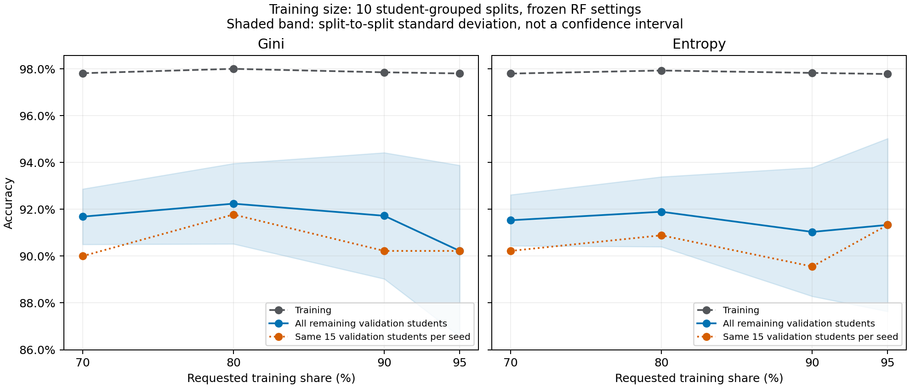

# Random Forest experiment log

Recorded on 2026-11-24 (America/Toronto). Earlier results and selected
hyperparameters are preserved. This log distinguishes historical holdout
results, cross-validation results, and the new training-size experiment.

## Dataset and measurement conventions

- Original data: 870 responses from 290 students, three sports per student.
- Classes: Soccer, Baseball, Basketball. Student IDs never enter the model.
- Split by student, not by response row. Each student belongs to one partition
  within a run.
- Report accuracy and macro-F1. A training/validation gap is a diagnostic, not
  proof of overfitting by itself.
- Fit imputation values and text vocabularies on training responses only.
- The retained RF preprocessing uses all 12 questions, including numeric
  ratings, multi-select indicators, parsed ticket prices, binary text features,
  and missing-value indicators. All rows are retained.
- The historical RF feature CSV has 326 features. New splits refit vocabularies
  and can produce different feature counts while using the same recipe.
- Historical 50/20/30 partitions contain 435 training, 174 validation, and
  261 local test responses. The course's hidden TA/instructor test set is
  distinct from this local test set.

## 1. Original eight-feature baseline

Settings: 100 trees, unlimited depth, `min_samples_split=2`,
`min_samples_leaf=1`, `max_features="sqrt"`, bootstrap sampling, forest seed 42.
Features covered beginner ease, three Likert questions, and four seasons.
Missing values used training medians. No scaling was applied.

| Criterion | Training accuracy | Validation accuracy | Validation macro-F1 |
|---|---:|---:|---:|
| Gini | 93.33% | 64.37% | 0.6438 |
| Entropy | 93.33% | 62.64% | 0.6263 |

The large training/validation gap indicated weak generalization with this
limited representation. These were untuned baselines, not final models.

Evidence: [original Gini run](../../results/random_forest_20261122T030021_458837Z/metrics.csv)
and [criterion comparison](../../results/random_forest_comparison_20261122T041912_195651Z/comparison.csv).

## 2. RF-specific preprocessing across all questions

The same baseline settings were rerun with RF v1 preprocessing. Text
vocabularies used at most 80 words per field and a minimum training document
frequency of two. Missing numeric values used training medians. Ambiguous
prices remained missing, with separate missingness flags.

| Criterion | Training accuracy | Validation accuracy | Validation macro-F1 |
|---|---:|---:|---:|
| Gini | 99.31% | 93.10% | 0.9309 |
| Entropy | 99.31% | 91.95% | 0.9187 |

The improvement reflects both additional predictors and preprocessing; it
cannot be attributed to cleaning alone.

Evidence: [expanded-feature comparison](../../results/random_forest_comparison_20261124T002917_142972Z/comparison.csv).

## 3. Historical local test evaluation

Both untuned 100-tree baselines from experiment 2 were evaluated on the
original 261-response local test split. They trained only on the 435 training
responses. Gini had been preferred using validation scores before test scoring.

| Criterion | Local test accuracy | Local test macro-F1 |
|---|---:|---:|
| Gini | 88.12% | 0.8815 |
| Entropy | 86.97% | 0.8695 |

These are historical baseline scores. They are not test scores for the later
tuned model or the new training-size experiment. The local test set was
exposed at this point and should not be described as never previously seen.

Evidence: [evaluation metrics](../../results/random_forest_evaluation_20261124T003339_457071Z/metrics.csv).

## 4. Bounded hyperparameter search

A two-stage, 46-configuration search used the original training/validation
split. Stage 1 sampled structural settings for both criteria: depth
`[5, 10, 20, None]`, minimum leaf sizes `[1, 2, 5]`, and minimum split sizes
`[2, 5, 10]`. Stage 2 compared 100/300 trees and `sqrt`/`log2`/0.3 feature
sampling for each criterion's structural winner. The forest seed stayed 42.

Selection maximized validation macro-F1, then accuracy, with deterministic
complexity tie-breakers. No new test evaluation was performed.

| Criterion/configuration | Training accuracy | Validation accuracy | Validation macro-F1 |
|---|---:|---:|---:|
| Gini baseline | 99.31% | 93.10% | 0.9309 |
| Gini tuned | 98.85% | 94.25% | 0.9422 |
| Entropy baseline | 99.31% | 91.95% | 0.9187 |
| Entropy individually tuned | 92.87% | 93.68% | 0.9364 |

Selected Gini configuration, retained in [tuned_params.json](tuned_params.json):

```python
n_estimators = 300
max_depth = None
min_samples_split = 10
min_samples_leaf = 1
max_features = "log2"
seed = 42
criterion = "gini"
```

The separate entropy winner used 100 trees, depth 5,
`min_samples_split=5`, `min_samples_leaf=1`, and `max_features="sqrt"`.
That historical choice remains recorded; it was not overwritten by subsequent
matched-parameter criterion comparisons.

The Gini validation gain was two additional correct predictions out of 174.
These are scores used for selection, not independent generalization estimates.

Evidence: [all trials](../../results/random_forest_tuning_20261124T004331_524702Z/trials.csv),
[baseline versus tuned](../../results/random_forest_tuning_20261124T004331_524702Z/baseline_vs_tuned.csv),
and [configuration replay](../../results/random_forest_gini_20261124T004402_028162Z/metrics.csv).

## 5. Main preprocessing versus RF v1

The original raw CSV was byte-identical between branches. Main at commit
`1e2acaa9959dee5557dac8182dd8f81d7990e120` used a different preprocessing recipe:
up to 200 text terms per field, Likert mode imputation, and stricter price
parsing. Both versions were fitted on the same 435 training responses and
evaluated on the same 174 validation responses with the frozen tuned Gini.

| Preprocessing | Features | Validation accuracy | Validation macro-F1 | Training prices missing/unparsed |
|---|---:|---:|---:|---:|
| RF v1 | 326 | 94.25% | 0.9422 | 18 |
| Main | 592 | 91.95% | 0.9193 | 75 |

Both passed finite-value and row/column alignment checks. More parsed prices
do not by themselves establish better semantic correctness; the parser rules
differ. RF v1 was retained because it performed better for the RF model under
matched conditions, not because it is universally better for every model.

Evidence: [preprocessing comparison](../../results/random_forest_5fold_20261125T030257_299777Z/preprocessing_comparison.csv).

## 6. Five student-grouped development folds

The original 261-response local test split was excluded from this run. The
other 609 responses from 203 students were divided into five groups with
seed 43. Each fold fitted a fresh RF v1 preprocessor on its own training rows.
Every development response received exactly one out-of-fold prediction.

Both criteria used the frozen 300-tree Gini structural settings from
experiment 4, changing only `criterion`. In particular, the entropy row below
is not the separately tuned shallow entropy configuration from experiment 4.

| Criterion | Mean accuracy | Accuracy standard deviation | Mean macro-F1 | Macro-F1 standard deviation |
|---|---:|---:|---:|---:|
| Gini | 92.93% | 2.15 percentage points | 0.9293 | 0.0212 |
| Entropy, matched structure | 93.27% | 2.49 percentage points | 0.9326 | 0.0246 |

Entropy made two more correct out-of-fold predictions across 609 responses.
This small difference does not establish a consistent superiority. Parameters
and preprocessing had already been selected using part of this data, so the
results assess stability and are not nested CV or a fresh independent test.

Evidence: [fold metrics](../../results/random_forest_5fold_20261125T030257_299777Z/metrics_by_fold.csv)
and [summary](../../results/random_forest_5fold_20261125T030257_299777Z/metrics_summary.csv).

## 7. New training-size experiment

The new experiment deliberately ignores the previous partition assignments
and makes all 870 original responses eligible for training or validation.
Previous CSVs, split assignments, selected configurations, and results remain
unchanged. There is no separate untouched test set in this experiment.

Protocol fixed before examining the new results:

- Requested training shares: 70%, 80%, 90%, and 95%, with all remaining
  students used for validation. Training student counts are rounded down.
- Ten split seeds: 42 through 51. Forest seed stays 42.
- For each seed, use one shuffled student order and increasing training
  prefixes. Training cohorts are nested as the fraction increases.
- Keep the same model settings as experiment 6: 300 trees, unlimited depth,
  split minimum 10, leaf minimum 1, `log2` feature sampling. Run both Gini and
  entropy without tuning either one. Total: 80 model fits.
- Refit numeric imputation and text vocabularies inside each training subset.
  Never reuse the feature matrix fitted for the old 50/20/30 split.
- Record training/validation accuracy and macro-F1, their gaps, and sample
  standard deviations across split seeds.
- Also evaluate the same 15 validation students within each seed across all
  four fractions. This common-cohort diagnostic helps separate a training-size
  effect from the changing composition of the full validation remainder.
- Repeated splits overlap. Their standard deviations describe sensitivity to
  splits; they are not confidence intervals or independent replications.

| Requested training share | Training students/rows | Validation students/rows |
|---|---:|---:|
| 70% | 203 / 609 | 87 / 261 |
| 80% | 232 / 696 | 58 / 174 |
| 90% | 261 / 783 | 29 / 87 |
| 95% | 275 / 825 | 15 / 45 |

The actual final training share is 275/290 = 94.83%, because a student cannot
be split across partitions. With only 45 validation responses at that ratio,
one mistake changes accuracy by 2.22 percentage points. Increasing the training
share does not guarantee a higher observed validation score.

Reproduce the experiment with:

```bash
python models/random_forest/training_size_experiment.py
```

### Verified results

Each cell reports a mean across 10 split seeds. The ± values are sample standard deviations, not confidence intervals.

| Criterion | Training share | Training accuracy | Validation accuracy ± SD | Validation macro-F1 ± SD | Accuracy gap |
|---|---:|---:|---:|---:|---:|
| Gini | 70% | 97.82% | 91.69% ± 1.19 pp | 0.9168 ± 0.0119 | 6.13 pp |
| Gini | 80% | 98.00% | 92.24% ± 1.72 pp | 0.9225 ± 0.0170 | 5.76 pp |
| Gini | 90% | 97.85% | 91.72% ± 2.70 pp | 0.9170 ± 0.0271 | 6.13 pp |
| Gini | 95% | 97.81% | 90.22% ± 3.66 pp | 0.9017 ± 0.0368 | 7.58 pp |
| Entropy | 70% | 97.80% | 91.53% ± 1.09 pp | 0.9153 ± 0.0110 | 6.27 pp |
| Entropy | 80% | 97.93% | 91.90% ± 1.49 pp | 0.9189 ± 0.0150 | 6.03 pp |
| Entropy | 90% | 97.83% | 91.03% ± 2.75 pp | 0.9102 ± 0.0277 | 6.79 pp |
| Entropy | 95% | 97.78% | 91.33% ± 3.70 pp | 0.9127 ± 0.0378 | 6.45 pp |

Common-cohort accuracy uses the same 15 held-out students (45 responses) within each split seed at every training fraction:

| Training share | Gini common-cohort accuracy | Entropy common-cohort accuracy |
|---|---:|---:|
| 70% | 90.00% ± 4.09 pp | 90.22% ± 4.08 pp |
| 80% | 91.78% ± 3.64 pp | 90.89% ± 3.22 pp |
| 90% | 90.22% ± 3.81 pp | 89.56% ± 4.06 pp |
| 95% | 90.22% ± 3.66 pp | 91.33% ± 3.70 pp |

### Interpretation

1. **No monotonic validation gain was observed.** Full-remainder validation accuracy peaks at 80% training for both criteria in this experiment. This is an observation, not evidence that discarding training data improves the underlying model.
2. **Changing validation membership matters.** For Gini, the full-remainder score drops from 91.69% at 70% training to 90.22% at 95%, but its common-cohort score changes from 90.00% to 90.22%. The full-remainder drop therefore cannot be attributed solely to training size. The common-cohort curves also fluctuate rather than improving monotonically.
3. **A generalization gap remains.** Training accuracy stays near 97.8–98.0%, versus roughly 90.2–92.2% validation accuracy. Mean gaps are approximately 5.8–7.6 percentage points. This is consistent with some overfitting or limited generalization, but does not isolate the cause or prove that adding training data increases overfitting.
4. **The 95% estimate is less stable.** Full-validation standard deviation rises to about 3.7 percentage points for both criteria, compared with about 1.1–1.2 points at 70%. Only 15 students remain for validation, and responses within students are correlated.
5. **Keep the selected configuration unchanged.** Do not select a training fraction solely because it maximizes these exploratory scores. The prior single-split 94.25% and these repeated-split means use different membership and sample sizes and are not directly interchangeable.
6. **Scope of the evidence:** fixed model settings and a fixed preprocessing recipe were used, but vocabulary and medians changed with each training subset. The new experiment includes previously evaluated local-test students; it has no independent test set. Repeated splits overlap and prior feature/model choices used this dataset.

### Artifacts and verification

- [All 80 trial metrics](../../results/random_forest_training_size_20261125T033851_791399Z/trials.csv)
- [Summary statistics](../../results/random_forest_training_size_20261125T033851_791399Z/summary.csv)
- [Student split assignments](../../results/random_forest_training_size_20261125T033851_791399Z/split_assignments.csv.gz)
- [Training and validation predictions](../../results/random_forest_training_size_20261125T033851_791399Z/predictions.csv.gz)
- [Frozen experiment configuration](../../results/random_forest_training_size_20261125T033851_791399Z/experiment_config.json)
- [Hashes of preserved historical artifacts](../../results/random_forest_training_size_20261125T033851_791399Z/prior_artifact_hashes.json)

Verification recomputed all accuracy/F1 values from saved predictions, checked nested and disjoint student splits, confirmed the identical common cohort within each seed, replayed all 40 training-only preprocessing states, and checked summary means/standard deviations. All 80 protected historical artifacts and configuration/data files retained identical hashes.



